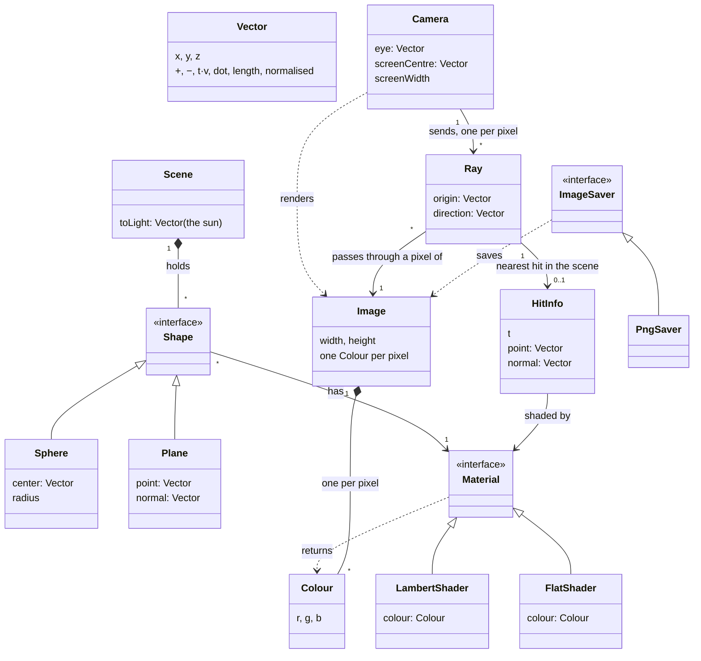

# Domain model

The ray tracer in the client's words: a **camera** sends one **ray** through
each **pixel** of the **image**; the ray may hit **shapes** of the **scene**;
the nearest hit's **material** decides the colour, lit by the **sun**.

`Vector` is the only box with operations, because the maths is part of the
domain. Decisions behind this model: ADR 0007 (a colour is not a vector),
0008 (points and directions are vectors), 0009 (coordinates), 0010 (`trace`
colours the pixel), 0011 (a shape has a material).

## Who does what

| Question | Answer |
|---|---|
| Which ray goes through this pixel? | `Camera::rayThroughPixel` |
| What does this ray hit first? | `Scene::nearestHit`, asking each `Shape` |
| What colour is that point? | its `Material::shade`, given the sun direction |
| Who colours the pixel? | `trace(ray, scene)` |
| Who writes the file? | an `ImageSaver` (`PngSaver`) |

## Glossary

- **Ray:** a half-line, `origin + t * direction` for `t > 0`.
- **t:** how far along a ray, in units of its direction.
- **Normal:** the unit vector perpendicular to a surface at a point, pointing out.
- **Lambert's law:** a matte surface's brightness is `max(0, N · L)`.
- **Sun / toLight:** a light so far away that its direction is the same
  everywhere; `toLight` points from the surface to it.
- **Pixel:** one cell of the image, counted from the top-left corner.
- **Screen:** the rectangle in front of the eye that the image is mapped onto.
